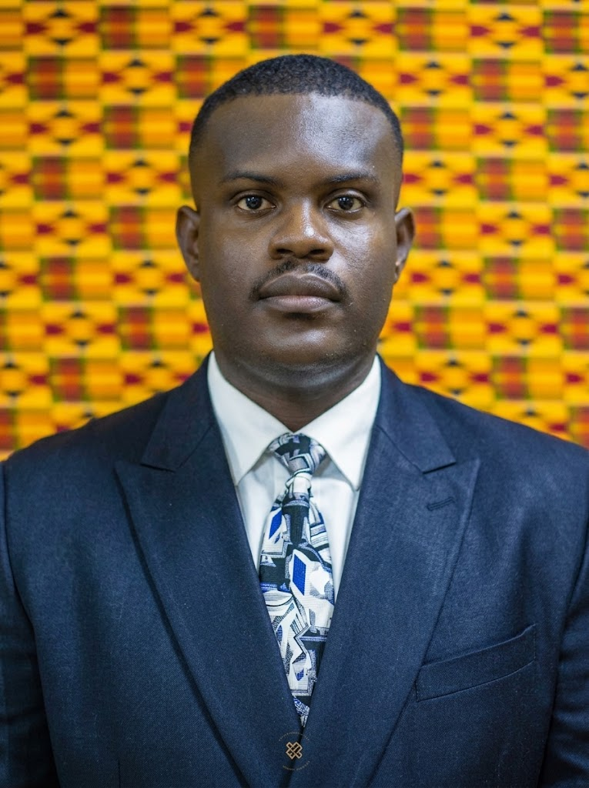
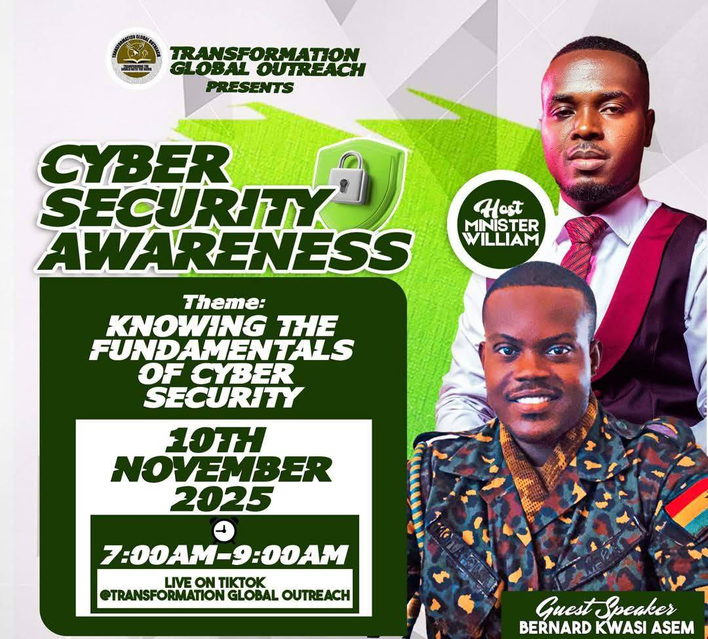
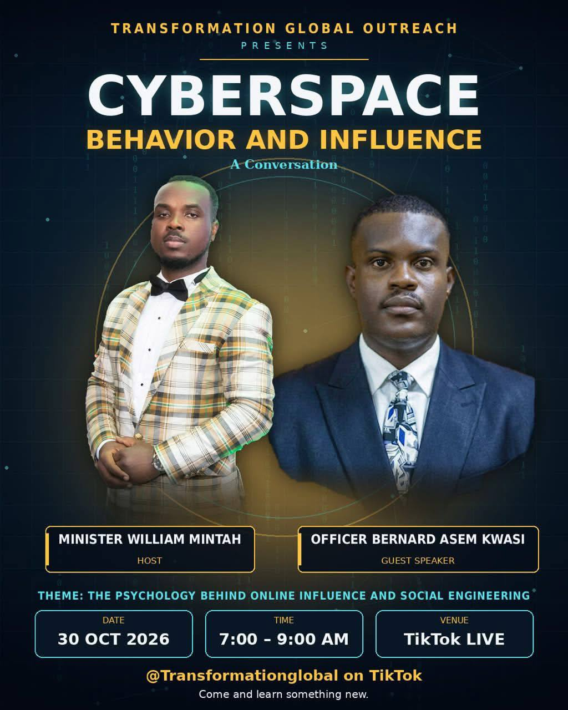

[CV](cv.md) 

# About Me
<table style="border: none; width: 100%;">
  <tr>
    <td style="width: 30%; vertical-align: top; border: none; text-align: center; padding-right: 20px;">
      
    </td>
    <td style="width: 70%; vertical-align: top; border: none;">
      <h2>Bernard Kwesi Asem</h2>
      
University of Business and Integrated Development Studies, BSc Computer Science

      
Assistant Immigration Control Officer I

      
Ghana Immigration Service

    </td>
  </tr>
</table>

Professional immigration officer with more than six (6) years of working experience in migration, with the Ghana Immigration Service. My main duties included and is not limited to MIS roles, Aide to the regional commander, supervising digital infrastructure for recruitments, verfication of applications for residence permits and issuance of same. I have a Bachelor of Science in Compter Science degree which i intend to use a foundation for pursuing a master's degree, and in the long run a PhD. I had my undergraduate studies in University of Business and Integrated Development Studies, located in Wa, Ghana.  

My interests are in Artificial Intelligence, Data Science, and its intersection with application areas in agriculture, cybersecurty, therapy, migration, and other areas. My short term goals evolve around designing long-lasting AI-driven systems, that will contribute to solving Ghana's critical digital deficit and administrative reforms, involving policy and initiative development, digital health and safety, agriculture sustainability and climate resilience.

Focusing on the implementation of my skills and experiences, I aim to take advantage of digital platforms like Tiktok to contribute to creating awareness on cybersecurity, mental health solutions and coping mechanisms for men. Below are links to some sessions held on TikTok on cybersecurity awareness:

---
[Cybersecurity Awareness](https://vt.tiktok.com/ZSgKAAqQ8/) ||
[Cyberspace Behavior](https://vt.tiktok.com/ZSgKDJd9r/)

## Talks and Shows

  
  

## Get in Touch
Feel free to connect with me!

  
  
  
  

